  

# 🚀 Awesome HTTP Traffic Interception & Capture

### ⚡ Curated Ecosystem of Modern MITM Proxies, DAST Suites, Traffic Sniffers & API Debuggers

  
  
  
  
  
  

  <b>A comprehensive, SEO-optimized directory of top open-source tools and SaaS platforms for HTTP/HTTPS proxying, SSL decryption, traffic capture, request replay, and application security testing.</b>

---

## 📌 Table of Contents
- [📖 Overview & Key Concepts](#-overview--key-concepts)
- [📊 Sector Overview & Market Dynamics](#-sector-overview--market-dynamics)
- [🏢 SaaS & Hosted Platforms](#-saashosted-platforms)
- [💻 Open-Source GitHub Projects](#-open-source-github-projects)
- [🤝 How to Contribute](#-how-to-contribute)
- [⭐ Star History](#-star-history)
- [💖 Support & Sponsorship](#-support--sponsorship)
- [⚠️ Disclaimer](#-disclaimer)

---

## 📖 Overview & Key Concepts

**HTTP Traffic Interception & Capture** enables security engineers, penetration testers, QA automation specialists, and frontend/backend developers to sit directly between a client (web browser, mobile application, CLI tool, or IoT client) and upstream servers. These tools allow real-time inspection, decryption, tampering, mocking, and replaying of HTTP/1.1, HTTP/2, HTTP/3 (QUIC), and WebSocket traffic.

### 🎯 Primary Use Cases:
- 🛡️ **Dynamic Application Security Testing (DAST) & Pentesting**: Identifying vulnerabilities (OWASP Top 10, SSRF, IDOR, SQLi, XSS) via active and passive proxy analysis.
- 🔄 **Request Tampering & Replay**: Modifying payloads, headers, cookies, and tokens on the fly using Repeater/Intruder workflows.
- 📱 **Mobile & Desktop API Debugging**: Inspecting TLS/SSL traffic from iOS/Android apps with custom CA root certificate injection.
- 🧪 **Mocking & CI/CD Integration**: Emulating downstream microservice responses, mocking edge cases, and automating API contract testing.
- 🔍 **Low-Level Network Packet Analysis**: Examining raw TCP/IP frame metrics and packet drops beneath the HTTP application layer.

---

## 📊 Sector Overview & Market Dynamics

The global market for HTTP traffic interception, web debugging proxies, and DAST (Dynamic Application Security Testing) is currently estimated at approximately **$3.6B to $4.3B**, with high-growth segments like DAST projected to exceed **$12B+ by 2032** at an estimated CAGR of 14–17%. 

Market dynamics reflect a **moderately fragmented landscape**: while foundational developer environments and enterprise security suites (such as Postman and PortSwigger's Burp Suite) command strong user lock-in and high brand concentration, the broader sector remains decentralized with specialized standalone utilities across desktop debugging (Proxyman, Fiddler, Charles), browser-layer interceptors (Requestly), and robust, independent open-source tools (mitmproxy, OWASP ZAP).

---

## 🏢 SaaS/Hosted Platforms

| Product | Company Valuation / Revenue | Description | Pricing (Starting) | Free Tier / Trial Limits |
|---------|-----------------------------|-------------|-------------------|--------------------------|
| **[Postman Interceptor](https://www.postman.com/)** | **$5.6B Valuation** (~$270M–$315M ARR) | Browser extension and proxy agent capturing HTTP/HTTPS traffic to route and sync with Postman collections. | **$9/month** (Solo, billed annually) or **$19/user/month** (Team, billed annually) | **Free forever plan**: Capped at 1 user account; basic local interceptor sync, cloud collaboration restricted. |
| **[Requestly](https://requestly.com/)** | **$4.0B Valuation (Parent BrowserStack)** (~$3M ARR pre-acquisition) | Browser extension and desktop client enabling network rule manipulation, header redirects, and API mocking without proxy setup. | **$8/member/month** (Lite plan, billed annually) | **Free forever plan**: Capped at 5 total rules (3 active rules max), 5 API mocks, and non-commercial personal use. |
| **[Fiddler Everywhere](https://www.telerik.com/fiddler)** | **$1.79B Market Cap** (~$978M Revenue, Progress Software) | Cross-platform desktop proxy debugging suite with visual traffic inspection, custom rule builders, and team request sharing. | **$13/user/month** (Pro, billed annually; commercial use) or **$7/user/month** (Lite) | **10-day free trial**: Fully functional, unconstrained access across all Pro/Enterprise features for 10 days. |
| **[Burp Suite Professional](https://portswigger.net/burp)** | **$112M Private Equity Round** (~$35M–$40M ARR, PortSwigger) | Industry-standard web application security workbench and intercepting proxy with automated scanners, intruder, and repeater. | **$499/user/year** (Burp Suite Professional) | **Free forever plan (Burp Community Edition)**: Capped manual toolkit—no project saving, scanner disabled, and Intruder attack speeds throttled. |
| **[Proxyman](https://proxyman.com/)** | **~$600K–$900K ARR** (Bootstrapped indie business) | High-performance native macOS, iOS, Windows, and Linux HTTPS debugging proxy with SSL proxying and local script tampering. | **$89 one-time** (Standard seat with 1 year of updates) | **Free forever plan**: Unlimited basic traffic capture; restricted to max 2 active rules (Map Local/Remote, Breakpoints) and 2 pinned domains. |
| **[Charles Proxy](https://www.charlesproxy.com/)** | **Bootstrapped Indie** (<$5M estimated revenue, XK72 Ltd) | Long-standing desktop web debugging proxy with SSL decryption, bandwidth throttling, and AJAX/AMF recording. | **$50 one-time** (1–4 single-user licenses; $400 site license) | **30-day free trial**: Unrestricted 30-day trial; after 30 days, sessions automatically shut down after 30 minutes of continuous use with startup delays. |

---

## 💻 Open-Source GitHub Projects

| Project | Star Badge | Description |
|---------|------------|-------------|
| **[mitmproxy](https://github.com/mitmproxy/mitmproxy)** |  | **The standard open-source scriptable MITM proxy for automated interception and capture.** MIT licensed, Python. Provides CLI (`mitmproxy`), web UI (`mitmweb`), and headless (`mitmdump`) interfaces with Python addon extensions for programmatic flow tampering. |
| **[bettercap](https://github.com/bettercap/bettercap)** |  | **Swiss army knife for 802.11, BLE, IPv4, and IPv6 network reconnaissance and MITM attacks.** Written in Go with modular interactive packet capture, HTTPS proxy interception, and active protocol credential sniffers. |
| **[OWASP ZAP](https://github.com/zaproxy/zaproxy)** |  | **The world's most widely deployed open-source DAST proxy.** Apache-2.0, Java. Features intercepting proxying, passive analysis, automated vulnerability scanners, baseline CI checks, and official LLM/MCP integrations. |
| **[Wireshark](https://github.com/wireshark/wireshark)** |  | **The world's leading network protocol analyzer.** GPL-2.0, C/C++. Captures raw frames across interfaces, inspects packet dissections, and isolates HTTP/HTTPS traffic at the packet and socket layer. |
| **[AnyProxy](https://github.com/alibaba/anyproxy)** |  | **Fully configurable HTTP/HTTPS proxy in Node.js by Alibaba.** Apache-2.0. Offers a customizable web-based traffic inspector dashboard and JavaScript-based interception rule hooks. |
| **[Requestly](https://github.com/requestly/requestly)** |  | **Open-source core client and extension for network interception and API mocking.** Modifies network traffic directly in browser sessions without requiring system-wide proxy or certificate configuration. |
| **[HTTP Toolkit](https://github.com/httptoolkit/httptoolkit)** |  | **Open-source HTTP(S) debugging proxy and interactive client.** AGPL-3.0. Features one-click interception targeting Android apps, Docker containers, browsers, and terminal sessions with Mockttp under the hood. |
| **[Proxify](https://github.com/projectdiscovery/proxify)** |  | **Versatile, portable proxy by ProjectDiscovery for capturing, manipulating, and replaying HTTP/HTTPS traffic on the fly.** Apache-2.0, Go. Supports request dumping, upstream proxy chaining, and traffic matching rules. |
| **[BrowserMob Proxy](https://github.com/lightbody/browsermob-proxy)** |  | **Automated HTTP capture utility tailored for Selenium and functional test suites.** Apache-2.0, Java. Captures performance data in HAR (HTTP Archive) format and manipulates browser traffic programmatically. |
| **[Martian](https://github.com/google/martian)** |  | **Google library and programmable proxy for intercepting and modifying HTTP/S traffic.** Apache-2.0, Go. Configured via declarative JSON modifiers, filters, and verifiers for end-to-end integration testing. |
| **[Perseid](https://github.com/andyintheshell/perseid)** |  | **Rust-native Burp Suite alternative—zero JVM runtime overhead.** MIT/Apache-2.0. Native desktop workbench (egui) featuring HTTP/1.1 and HTTP/2 interception, Repeater, Intruder, and WebSocket inspection. |
| **[OpenSec Studio](https://github.com/saghet/opensec-studio)** |  | **Ultra-fast Rust DevSecOps & DAST workbench.** Combines an intercepting MITM proxy, tamper console, Repeater, Intruder, and Nuclei-compatible YAML scanning engines with cold boot times under 180ms. |
| **[Reqlore](https://github.com/ibrasonic/Reqlore)** |  | **Accessibility-first web pentesting suite built as semantic HTML5.** Intercepting MITM proxy, request hold queues, Repeater, and Intruder engines designed for screen-reader (NVDA, JAWS, Orca) compatibility. |

---

## 🤝 How to Contribute

Contributions are warmly welcomed! Help keep this curated ecosystem fresh and up to date:

1. 🍴 Fork the repository.
2. 📝 Add or update entries in [README.md](file:///C:/Users/ishan/Documents/Projects/Awesome-HTTP-Traffic-Interception-Capture/README.md) following the existing format and star-sorted order.
3. 🏷️ Ensure links, star badges, and precise pricing/limits are verified.
4. 🚀 Submit a PR with a concise summary of the changes.

---

##  Star History

---

## 💖 Support & Sponsorship

Thank you for visiting and supporting the **Awesome HTTP Traffic Interception & Capture** project! If you find this curated collection useful for your development, debugging, or penetration testing workflow:

- ⭐ **Star this repository** to help others discover it!
- 🍴 **Fork and share** it with your fellow developers and security researchers.
- ☕ **Buy me a coffee / Sponsor**: If you'd like to support the ongoing maintenance and curation of open-source developer resources, consider sponsoring via the [GitHub Sponsors Dashboard](https://github.com/sponsors/ishandutta2007).

---

## ⚠️ Disclaimer

- 🛡️ This repository is a **community-curated index** intended solely for educational, development, and authorized security auditing purposes.
- 🔐 HTTP interception tools capture sensitive credentials, auth headers, and confidential session data; **only intercept and inspect traffic you own or have explicit authorization to test**.
- 🧹 Always remove test CA certificates from personal or client devices when debugging sessions conclude, and never distribute captured traffic flows containing sensitive tokens.
- ⚙️ **Select your tooling deliberately**: packet analyzers (Wireshark) inspect raw network protocols, MITM proxies (mitmproxy, Burp Suite, Charles) decrypt and tamper with HTTP/HTTPS application streams, and browser interceptors (Requestly) modify web traffic without proxy configurations.

---

  Made with ❤️ for developers, QA engineers, and security professionals worldwide.

